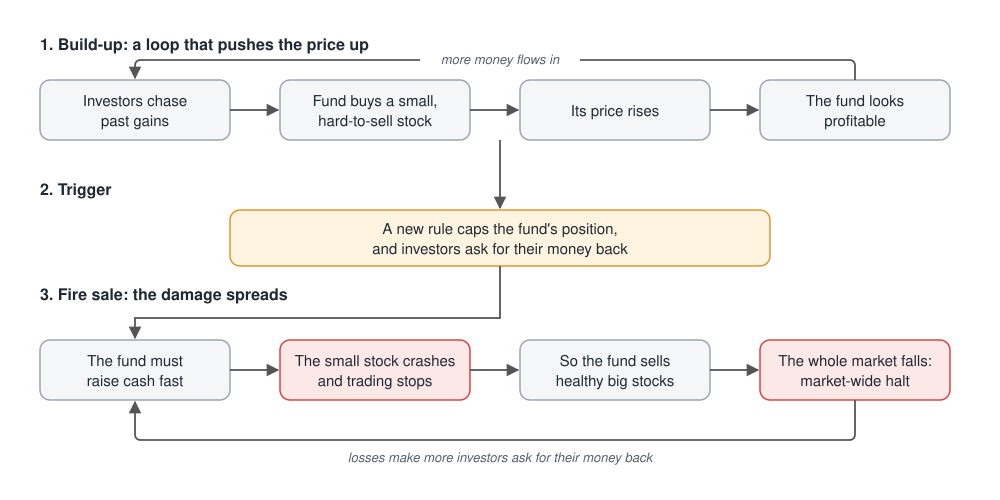
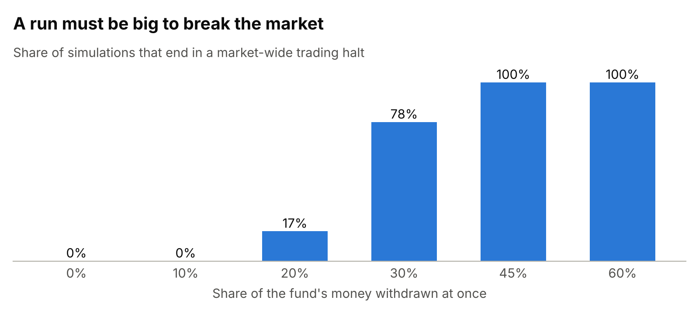
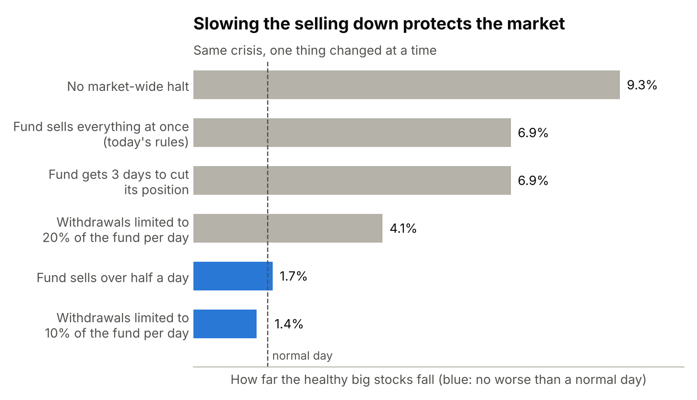
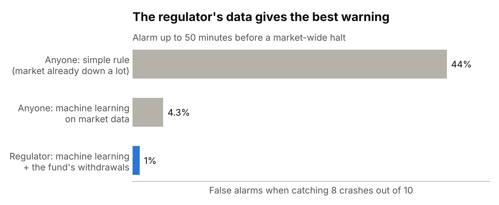

# ContagionSim

[](https://github.com/ccaglaa/contagionsim/actions/workflows/ci.yml)

**What happens to a stock market when a fund that owns too much of one small stock is forced to sell?**

ContagionSim is a stock market simulator written from scratch in Python. Simulated traders buy and sell five stocks under Borsa Istanbul's trading rules. One investment fund has bet heavily on a small stock. When investors pull their money out, the fund has to sell, and the simulator shows how the damage spreads to the rest of the market.

It is inspired by the 2026 Turkish investment fund crisis, when the market regulator (SPK) tightened its rules on concentrated funds and then ordered 131 funds to be liquidated. The model is simplified and does not represent any real fund or person.

## How a crisis unfolds in the model



The big stocks fall even though nothing is wrong with them. They fall because the fund owns them and sells them to pay its investors, and the selling grows when the small stock can no longer be sold.

## What I found

### 1. How big must the run be to break the market?

**About 30% of the fund's money.** When investors withdraw 10% or less, the market barely notices. From 30%, the market usually falls far enough to halt trading market-wide. The more of the small stock the fund owns, the worse the fall.



### 2. What limits the damage?

**Slowing the selling down.** I replayed the same crisis, changing one thing at a time, and measured how far the healthy big stocks fell:



- **If the fund sells over half a day instead of all at once,** the healthy stocks fall no more than on a normal day, and trading is never halted.
- **If investors can withdraw at most 10% of the fund per day,** the damage stops too, but investors wait: 27% of their money is still unpaid a day later.
- **Giving the fund more time to cut its position does not help the market,** because the selling is driven by the withdrawals.
- **The market-wide halt helps:** without it, the fall is deeper (9.3% instead of 6.9%), because the pause stops the fund from dumping.

### 3. Do standard risk models see it?

**No.** Banks and funds use a risk model called VaR to estimate the worst loss to expect 99 times out of 100. Three common versions work well in calm markets. In the crisis, the healthy stocks broke through that limit 13 to 18 times where about 4 were expected, and the worst moment lost 10 to 13 times more than the model allowed for. The models learn from the past, and the past was calm.

### 4. Can you see the crash coming?

**Only someone who sees the withdrawals can.** I trained models to raise an alarm up to 50 minutes before a market-wide halt. To catch 8 crashes out of 10, each watcher has to accept some false alarms:



The market only sees the selling once it starts. The regulator sees investors asking for their money back before that, and this is what makes the warning reliable.

### The common lesson

Everything that **slows the selling down** protects the market: a patient fund, a limit on withdrawals, a trading halt. The damage comes less from how much is sold than from how fast.

## Limits

- The market is simplified and not fitted to real Borsa Istanbul data, so the numbers show *how* things happen, not their exact real-world size.
- Only one fund is forced to sell. In a real panic, many sellers rush out together and waiting costs more.
- Investors do not change their behaviour when they expect a rule like a withdrawal limit.
- Some results rest on a few dozen crash events, so they carry real uncertainty (reported in the details).

## More detail

- [Detailed results](docs/results.md): method, statistical tests, confidence intervals and figures for each question.
- [Design notes](docs/design.md): how the order book, traders, fund and exchange rules work, and the bugs found along the way.

## Run it yourself

```bash
python3.12 -m venv .venv
source .venv/bin/activate
pip install -e ".[dev]"
python -m pytest -m "not slow"           # 131 tests, about 10 seconds
python experiments/q1_phase_diagram.py   # question 1 (~3 min)
python experiments/q2_liquidation.py     # question 2 (~3 min)
python experiments/q3_var_backtest.py    # question 3, risk models (~1 min)
python experiments/q3_policy.py          # question 3, rules (~2 min)
python experiments/q4_early_warning.py   # question 4 (~7 min)
```

Every run is seeded, so it gives the same numbers on any machine. Figures are saved to `results/`; `python experiments/readme_figures.py` redraws the three charts above.

**Built with** Python, NumPy, SciPy and scikit-learn, with strict type checking (mypy), 132 automated tests and continuous integration on every push.
