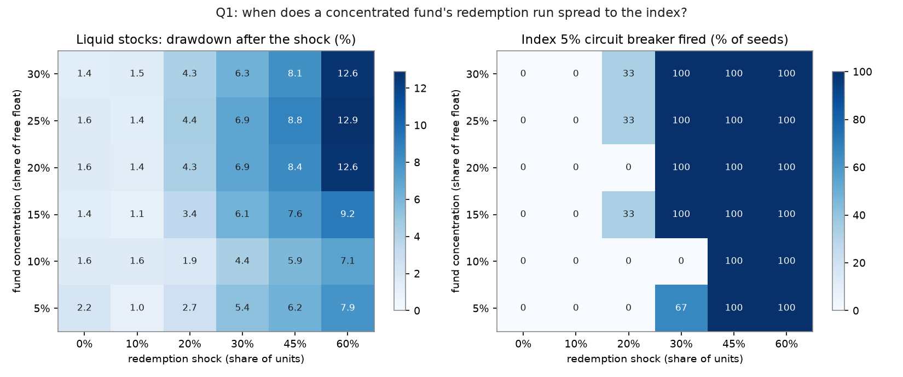
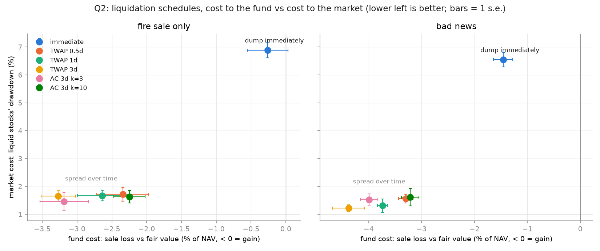
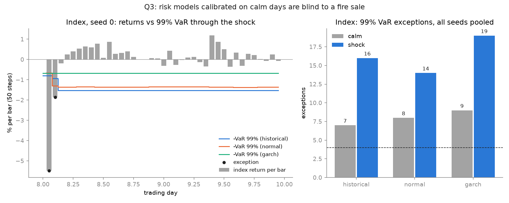

# ContagionSim

An agent-based limit order book simulator of how a fund concentrated in illiquid stocks can turn a redemption run into a cross-asset fire sale. Inspired by the 2026 Turkish investment fund crisis. The model is stylized and does not represent any real fund or person.

**Status:** work in progress. Done: matching engine, baseline market, fund build-up and unwind, multi-asset contagion with BIST-style rules, Q1 phase diagram, Q2 liquidation schedules, Q3 VaR backtest. Next: Q3 policy experiment, Q4 early warning.

## Questions

1. **When does it break?** At what concentration and redemption shock does an orderly market tip into limit-down and circuit breakers?
2. **How should a forced seller liquidate?** Naive dumping vs pro-rata vs an optimal-execution schedule (Almgren-Chriss).
3. **What do risk models and rules miss?** A GARCH / historical VaR backtest through the crash, and a policy experiment on position caps, redemption gates and price-limit widths.
4. **Can you see it coming?** An early-warning classifier for limit-down events from order book signals, evaluated with temporal splits and precision-recall.

## Quick start

```bash
python3.12 -m venv .venv
source .venv/bin/activate
pip install -e ".[dev]"
python -m pytest
python experiments/m2_baseline.py     # baseline market, saves results/m2_baseline.png
python experiments/m3_fund_unwind.py  # fund build-up and unwind, saves results/m3_fund_unwind.png
python experiments/m4_contagion.py    # contagion to the index, saves results/m4_contagion.png
python experiments/q1_phase_diagram.py  # Q1 heatmap, 108 runs on all CPU cores (~3 min)
python experiments/q2_liquidation.py    # Q2 liquidation schedules, 60 runs (~3 min on 8 cores)
python experiments/q3_var_backtest.py   # Q3 VaR backtest, 20 runs (~1 min on 8 cores)
python -m pytest -m "not slow"        # quick test run (skips the ~30 s scenario test)
```

## Layout

```
src/contagionsim/orderbook/   limit order book, price-time priority matching
src/contagionsim/market/      Market, Exchange (multi-asset, BIST-style rules), Simulation loops
src/contagionsim/agents/      NoiseTrader, MarketMaker, ValueTrader, Fund, PortfolioFund
src/contagionsim/execution/   liquidation schedules (immediate, TWAP, Almgren-Chriss)
src/contagionsim/scenarios.py mini BIST setup and news shocks, shared by experiments and tests
src/contagionsim/analysis/    stylized facts, contagion metrics, VaR models and backtests
src/contagionsim/sweep.py     parallel parameter sweeps (one process per CPU core)
experiments/                  one script per figure
tests/                        pytest suite
```

## Design notes (M1)

- **Prices are integer ticks.** Floats make `0.1 + 0.2 != 0.3`, which breaks price comparisons and dict keys. Conversion to currency happens at the exchange layer.
- **Book structure:** per side, a dict `price -> deque` (FIFO time priority within a level) plus a sorted list of active prices (best price lookup). A dict `order_id -> Order` makes cancel O(1) to locate.
- **Sequence numbers, not timestamps,** define time priority, so seeded runs are exactly reproducible.
- **Trades execute at the resting order's price.**
- **Market orders never rest.** The unfilled remainder is reported as cancelled.
- **Bad input raises; cancelling an unknown order returns `False`.** A zero-quantity order is a caller bug; cancelling an order that was just filled is normal in a simulation.
- **Invariants** (never crossed, no empty levels, index consistent, FIFO) are checked after every step of a randomized stress test.

## Design notes (M2)

- **Agents go through `Market`, never the book directly.** `Market` settles every trade into both accounts, so cash and shares are conserved by construction (tested).
- **One seeded `numpy` Generator** drives all randomness, and the agent order is reshuffled every step, so no agent gets a permanent queue advantage.
- **Noise traders** send Pareto-sized orders (many small, a few huge, like real order flow). This is what produces fat-tailed returns.
- **Market maker** quotes around a reservation price `mid - skew * inventory` with a half-spread that widens with EWMA volatility (a simplified Avellaneda-Stoikov rule), stops quoting the side that would breach its inventory limit, and never crosses the book (post-only).
- **Baseline result (seed 0, 20k steps):** the book is two-sided 99.9% of the time, the mean spread is 2.5 ticks, and 20-step returns have excess kurtosis of about 33 (fat tails). The market maker takes part in about 11% of the volume, stays profitable, and keeps its inventory within a few hundred shares.
- **Known gap:** volatility clustering is weak (acf of |r| about 0.04), because noise traders act independently of the past. Feedback agents (fund flows, momentum retail investors) come in M3.

## Design notes (M3)

- **Fund:** NAV = cash - redemptions owed + shares x price. Investors chase performance: every 100 steps, flow = 2% + 2 x (return over the last 5 periods) + noise, capped at +/-10% of NAV.
- **Reflexive build-up:** the fund invests inflows in its one stock, which pushes the price up. NAV rises and attracts more inflows. The fund's own limit is 25% of free float.
- **First-mover advantage:** redeemers are paid at today's NAV, and the selling needed to pay them happens afterwards, so the price impact lands on the investors who stay (tested).
- **Value traders** buy below and sell above a fundamental value, with limited capacity. Short selling is much more limited than buying (500 vs 5,000 shares each), as on BIST. This is why the price can be pushed far above value.
- **Shock:** a regulator caps holdings at 8% of free float, and 30% of units are redeemed. The fund sells naively, all at once with market orders.
- **Result (seed 0):** the build-up pushes the price 29% above value. The forced sale of 17,000 shares crashes it to 23% *below* value, a fire-sale discount: value buyers hit their full 25,000-share capacity and cannot absorb more. Remaining investors lose 13% of NAV. Without the shock, the price stays inflated.
- **Known gaps:** without price limits the crash happens within a single step. Spreads barely widen, because value traders refill the book. Both are addressed in M4 (price limits, circuit breaker, multi-asset contagion).

## Exchange rules (M4)

Modeled on Borsa Istanbul. Every value is a parameter in `market/rules.py`.

| Segment | Daily price limit | Stock circuit breaker | Auction after a halt |
|---|---|---|---|
| Yildiz Pazar | +/-20% | 10% | 5 min collect + 2 min match |
| Ana Pazar | +/-15% | 7.5% | 15 min collect + 2 min match |
| Alt Pazar | +/-10% | 5% | 15 min collect + 2 min match |

- **Daily limit:** measured from the base price (previous close). Orders priced outside the band are rejected, and market orders stop at the band edge, so a stock can be *locked* at limit-down.
- **Stock circuit breaker:** an order that would trade beyond the trigger, measured from the reference price, halts the stock and starts a call auction. The auction price becomes the new reference.
- **Call auction:** orders collect without matching, then everything executes at one price. That price maximizes volume, then minimizes the leftover imbalance, then sits closest to the reference price.
- **Index circuit breaker:** a capitalization-weighted index falling 5% or 7% below the previous close halts every stock for 20 + 5 + 5 minutes. Each stage fires once per day.
- **Time:** one trading day is 1,000 steps, about 2 steps per minute of an 8-hour session.
- **Simplifications:** market orders are refused during auctions. The 20-minute index halt also accepts orders, so it is one long collection period. There is no end-of-session rule.

Sources: [Borsa Istanbul tick-size announcement (6/11/2023), via Phillip Capital](https://phillipcapital.com.tr/Files/OfficialAnnouncement/225f6ec0-7684-44eb-ae43-35cb8926eff1.pdf); [Is Yatirim, trading rules notice (price limits and circuit breakers by segment)](https://www.isyatirim.com.tr/tr-tr/Resmi-Duyurular/Documents/İşlem%20Kuralları%20Bildirim%20Formu.pdf); [Midas, circuit breakers on Borsa Istanbul (updated 29/09/2026)](https://www.getmidas.com/destek/borsa-istanbul/bist-piyasa-bilgileri/borsa-istanbulda-devre-kesici-nedir); [Forbes Turkiye, index circuit breaker triggered twice (19/03/2025)](https://www.forbes.com.tr/ekonomi/borsada-islemler-devre-kesicinin-calismasiyla-ikinci-kez-gecici-olarak-durduruldu).

## Contagion (M4)

**Setup (`scenarios.mini_bist`).**
- **CORNER** is a small cap on Ana Pazar. Four liquid large caps (**L1 to L4**) are on Yildiz Pazar, and they form a cap-weighted index with the 5% / 7% circuit breaker.
- The liquid stocks are 5 times deeper: bigger orders, a bigger market maker, and more arbitrage capital, with shorting allowed.
- The **PortfolioFund** puts up to 25% of CORNER's free float into CORNER and spreads the rest equally across the liquid stocks. It soft-closes at 2.5M TRY.

**Selling rule: sell what can be sold.** The cash needed is split across holdings by value, but only over stocks that can trade right now. A stock that is halted or locked at limit-down is skipped.

**Two contagion channels, measured separately (`analysis/contagion.py`).**
1. **Common ownership (the main one).** The fund holds the liquid stocks, so it sells them to pay redeemers. The liquid stocks fall because of who owns them, not because anything is wrong with them.
2. **Diversion.** Halts and limit-down on the cornered stock push even more of the selling onto the liquid stocks. In a 30% redemption-only run (seed 0), CORNER is 16% of the fund's holdings but only 6% of what it sold. The other 10 percentage points land on the liquid stocks.

**Result (shock on day 8: CORNER cap cut to 8% of float, 30% of units redeemed).**

| | Calm run | Shocked run |
|---|---|---|
| CORNER low after the shock | -3% to -7% | -27% to -31% |
| Liquid stocks, average low | -1.2% to -1.8% | -6.1% to -7.4% |
| Index circuit breaker, 5% stage | 0 of 4 seeds | 4 of 4 seeds |
| Index circuit breaker, 7% stage | 0 of 4 seeds | 3 of 4 seeds |

Seed 0: the fund sold 17,000 CORNER shares and 124,679 liquid shares. Here the regulatory cap forces CORNER sales, so CORNER's share of sales (16%) matches its weight. Diversion appears in the redemption-only runs (see Q1). Remaining investors lost 10% of NAV. The liquid stocks recover within about 2 days as value traders buy back. CORNER does not recover.

**Calibration notes (each fix was found by a test or a figure).**
- **Inflows:** 10 flow events a day compounded without limit and created a bubble in the liquid stocks even in the calm run. Fix: a soft close (`max_aum`).
- **Fund size:** too small, and the shock was absorbed by cash; too large, and the fund pumped the large caps. The chosen size sits between the two.
- **Circuit-breaker bug:** after an auction with no trade, the reference price did not move, so a stock at the band edge halted every 14 steps forever. Fixed, with a regression test.

## Q1: When does it break?

`experiments/q1_phase_diagram.py` runs a grid of fund concentration in CORNER (5% to 30% of free float) against a one-off redemption on day 8 (0% to 60% of units, with no regulatory cap). Each cell uses 3 seeds, and every cell uses the same seeds ("common random numbers"), so cells differ only in the two parameters.



**Findings (3 seeds per cell).**
- **There is a tipping point near 30% redemption.** At 10% redemption or less, the liquid stocks move no more than in the no-shock column (about 1.5%) and the index breaker never fires. At 30% redemption the 5% index breaker fires in every seed once concentration is at least 15%. At 45% and above it always fires.
- **Concentration amplifies the damage.** At 60% redemption, the liquid stocks fall 7.9% at 5% concentration but about 12.7% at 20% to 30%.
- **Diversion grows with concentration.** The gap between CORNER's portfolio weight and its share of sales rises from under 1 percentage point at 5% concentration to about 15 at 30%. The more the fund is locked into the cornered stock, the more its selling lands on everything else.
- **Uncertainty:** 3 seeds per cell is a small sample. The 10% concentration row at 30% redemption (0 of 3 seeds, against 2 of 3 at 5%) is within noise. Use `--seeds 10` for tighter estimates.

## Q2: How should a forced seller liquidate?

`experiments/q2_liquidation.py` runs the M4 shock (CORNER cap cut to 8% plus 30% redemptions) with the fund following one of six liquidation schedules (`execution/schedules.py`):

- **immediate:** sell everything at once (the M4 fund).
- **TWAP:** equal amounts per step over half a day, 1 day or 3 days.
- **Almgren-Chriss over 3 days:** the optimal trajectory `x(u) = X sinh(k(1-u)) / sinh(k)`, with urgency `k = kappa T` and `kappa = sqrt(lambda sigma^2 / eta)`. A low `k` gives back TWAP; a high `k` front-loads the selling toward immediate.

There are two scenarios: a pure fire sale, and **bad news**, where the market learns at the shock that CORNER is worth 20% less. Each cell uses 5 seeds.

**Two costs.**
- **Cost to the fund:** sale loss against fair value, as a % of NAV. Negative means the fund sold above fair value. Fair value is used instead of NAV because a slow seller's unsold shares are marked at inflated market prices, which would flatter it.
- **Cost to the market:** the drawdown of the liquid stocks.



**Findings (5 seeds).**
- **Dumping is dominated.** It is worst for the fund and worst for the market, and it trips the 5% index breaker in every seed.
- **Spreading over just half a day removes the contagion.** The liquid stocks' drawdown falls from 6.9% to 1.7%, the no-shock level, and the index breaker fires in no seed. Longer horizons keep helping the fund (TWAP over 3 days is best), while the market cost is already at baseline.
- **Almgren-Chriss behaves as the theory says.** Patient (k=3) is close to TWAP over 3 days; urgent (k=10) is close to TWAP over half a day.
- **The classic trade-off barely appears.** Almgren-Chriss balances price impact against the risk of waiting. Here waiting is cheap, even with bad news: impact is mostly temporary (value traders restore prices), and bad news is absorbed slowly because shorting is constrained and nobody else is selling.
- **Caveats.** This is the main limitation of the result: with other forced or informed sellers running for the exit (a real run), waiting would cost more and the trade-off would return. Also, a slower fund pays redeemers later. In reality fund settlement takes a few days, so half a day to 3 days is realistic, but longer would not be.

## Q3: What do standard risk models miss?

`experiments/q3_var_backtest.py` runs 10 seeds, each twice: a calm run, and the M4 shock (CORNER cap cut to 8% plus 30% redemptions). Prices are cut into bars of 50 steps (20 per day).

- **Three models:** historical simulation, normal VaR with a rolling volatility, and GARCH(1,1). GARCH is fitted by maximum likelihood with variance targeting (`analysis/var.py`, written from scratch and tested against simulated GARCH data).
- **Estimation:** days 1 to 7. Day 0 is skipped as start-up.
- **Backtest window:** days 8 and 9, 400 bars pooled over seeds.
- **Tests:** Kupiec (is the number of exceptions right?) and Christoffersen (are exceptions independent?), combined as conditional coverage at the 5% level.

The calm runs are the control. A model that fails there is simply a bad model; a model that passes there and fails in the shock is blind to this kind of event.



**Findings (10 seeds).**
- **Calm control:** all three models pass on the index and the liquid stocks at both 99% and 95%.
- **Shock:** every model is rejected on every series. The liquid stocks, which have nothing wrong with them, see 13 to 18 exceptions of their 99% VaR where 4 are expected. The single worst bar loses 10 to 13 times the 99% VaR.
- **Counting exceptions is not enough.** At 95%, a count-only test (Kupiec) would pass 4 of the 6 shocked index and liquid models (p = 0.08 to 0.37). They are rejected only because the exceptions cluster (Christoffersen p of 0.002 or less). A fire sale concentrates the misses into a few bars, so the total over the window can look normal.
- **GARCH cannot learn what it has not seen.** On the calm days, volatility barely clusters, so GARCH often estimates alpha close to 0 and its VaR stays flat through the crash (seed 0 in the figure).
- **CORNER:** before the shock, at 95%, the normal and GARCH models are rejected for too few exceptions. The build-up period's volatility inflated their estimates, making them over-conservative.

**Bug found while building this:** the first GARCH version started the variance recursion differently in estimation (sample variance) and in forecasting (long-run variance). On data with little clustering, the fit found degenerate parameters (alpha close to 0, beta close to 1, omega close to 0) whose long-run variance was near zero, so the VaR was 4 times too small. Variance targeting and a consistent starting point fixed it, and there is a regression test.
