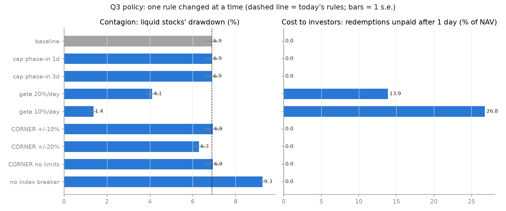
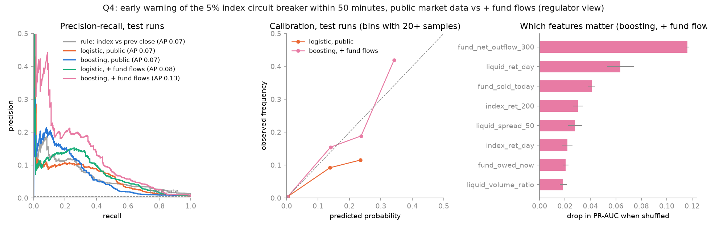

# Detailed results

The full method, numbers and caveats behind each answer in the [README](../README.md). The terms used here are defined in [design.md](design.md).

**The standard shock** (used in Q2 and Q3): on day 8 the regulator cuts the fund's cap on CORNER to 8% of free float, and 30% of the fund's units are redeemed.

## Q1: When does it break?

`experiments/q1_phase_diagram.py` runs a grid of fund concentration in CORNER (5% to 30% of free float) against a one-off redemption on day 8 (0% to 60% of units, with no regulatory cap). Each cell uses 3 seeds, and every cell uses the same seeds ("common random numbers"), so cells differ only in the two parameters.

**Findings (3 seeds per cell).**
- **There is a tipping point near 30% redemption.** At 10% redemption or less, the liquid stocks move no more than in the no-shock column (about 1.5%) and the index breaker never fires. At 30% redemption the 5% index breaker fires in every seed once concentration is at least 15%. At 45% and above it always fires.
- **Concentration amplifies the damage.** At 60% redemption, the liquid stocks fall 7.9% at 5% concentration but about 12.7% at 20% to 30%.
- **Diversion grows with concentration.** The gap between CORNER's portfolio weight and its share of sales rises from under 1 percentage point at 5% concentration to about 15 at 30%. The more the fund is locked into the cornered stock, the more its selling lands on everything else.
- **Uncertainty:** 3 seeds per cell is a small sample. The 10% concentration row at 30% redemption (0 of 3 seeds, against 2 of 3 at 5%) is within noise. Use `--seeds 10` for tighter estimates.

## Q2: How should a forced seller liquidate?

`experiments/q2_liquidation.py` runs the standard shock with the fund following one of six liquidation schedules (`execution/schedules.py`):

- **immediate:** sell everything at once with market orders.
- **TWAP:** equal amounts per step over half a day, 1 day or 3 days.
- **Almgren-Chriss over 3 days:** the optimal trajectory `x(u) = X sinh(k(1-u)) / sinh(k)`, with urgency `k = kappa T` and `kappa = sqrt(lambda sigma^2 / eta)`. A low `k` gives back TWAP; a high `k` front-loads the selling toward immediate.

There are two scenarios: a pure fire sale, and **bad news**, where the market learns at the shock that CORNER is worth 20% less. Each cell uses 5 seeds.

**Two costs.**
- **Cost to the fund:** sale loss against fair value, as a % of NAV. Negative means the fund sold above fair value. Fair value is used instead of NAV because a slow seller's unsold shares are marked at inflated market prices, which would flatter it.
- **Cost to the market:** the drawdown of the liquid stocks.

**Findings (5 seeds).**
- **Dumping is dominated.** It is worst for the fund and worst for the market, and it trips the 5% index breaker in every seed.
- **Spreading over just half a day removes the contagion.** The liquid stocks' drawdown falls from 6.9% to 1.7%, the no-shock level, and the index breaker fires in no seed. Longer horizons keep helping the fund (TWAP over 3 days is best), while the market cost is already at baseline.
- **Almgren-Chriss behaves as the theory says.** Patient (k=3) is close to TWAP over 3 days; urgent (k=10) is close to TWAP over half a day.
- **The classic trade-off barely appears.** Almgren-Chriss balances price impact against the risk of waiting. Here waiting is cheap, even with bad news: impact is mostly temporary (value traders restore prices), and bad news is absorbed slowly because shorting is constrained and nobody else is selling.
- **Caveats.** This is the main limitation of the result: with other forced or informed sellers running for the exit (a real run), waiting would cost more and the trade-off would return. Also, a slower fund pays redeemers later. In reality fund settlement takes a few days, so half a day to 3 days is realistic, but longer would not be.

## Q3: What do standard risk models miss?

`experiments/q3_var_backtest.py` runs 10 seeds, each twice: a calm run, and the standard shock. Prices are cut into bars of 50 steps (20 per day).

- **Three models:** historical simulation, normal VaR with a rolling volatility, and GARCH(1,1). GARCH is fitted by maximum likelihood with variance targeting (`analysis/var.py`, written from scratch and tested against simulated GARCH data).
- **Estimation:** days 1 to 7. Day 0 is skipped as start-up.
- **Backtest window:** days 8 and 9, 400 bars pooled over seeds.
- **Tests:** Kupiec (is the number of exceptions right?) and Christoffersen (are exceptions independent?), combined as conditional coverage at the 5% level.

The calm runs are the control. A model that fails there is simply a bad model; a model that passes there and fails in the shock is blind to this kind of event.

**Findings (10 seeds).**
- **Calm control:** all three models pass on the index and the liquid stocks at both 99% and 95%.
- **Shock:** every model is rejected on every series. The liquid stocks, which have nothing wrong with them, see 13 to 18 exceptions of their 99% VaR where 4 are expected. The single worst bar loses 10 to 13 times the 99% VaR.
- **Counting exceptions is not enough.** At 95%, a count-only test (Kupiec) would pass 4 of the 6 shocked index and liquid models (p = 0.08 to 0.37). They are rejected only because the exceptions cluster (Christoffersen p of 0.002 or less). A fire sale concentrates the misses into a few bars, so the total over the window can look normal.
- **GARCH cannot learn what it has not seen.** On the calm days, volatility barely clusters, so GARCH often estimates alpha close to 0 and its VaR stays flat through the crash (seed 0 in the figure).
- **CORNER:** before the shock, at 95%, the normal and GARCH models are rejected for too few exceptions. The build-up period's volatility inflated their estimates, making them over-conservative.

**Bug found while building this:** the first GARCH version started the variance recursion differently in estimation (sample variance) and in forecasting (long-run variance). On data with little clustering, the fit found degenerate parameters (alpha close to 0, beta close to 1, omega close to 0) whose long-run variance was near zero, so the VaR was 4 times too small. Variance targeting and a consistent starting point fixed it, and there is a regression test.

## Q3 (policy): Which rules limit the contagion?

`experiments/q3_policy.py` gives the naive fund (it dumps immediately) the standard shock and changes one rule at a time. Each policy uses 5 seeds.

- **Cap phase-in:** the regulator lets the fund sell its CORNER excess over 1 or 3 days.
- **Redemption gate:** at most 20% or 10% of NAV can be paid out per day, and the rest waits. Queued money is still owed, so it is subtracted from NAV.
- **CORNER's segment:** a daily limit of +/-10% or +/-20%, or no limit at all.
- **Index circuit breaker off.**

| Policy | Liquid stocks' drawdown | 5% index breaker | CORNER drawdown | Unpaid after 1 day (% of NAV) |
|---|---|---|---|---|
| Today's rules | 6.9% | 100% | 29% | 0 |
| Cap phase-in, 1 or 3 days | 6.9% | 100% | 29% / 21% | 0 |
| Gate 20% per day | 4.1% | 20% | 29% | 14 |
| Gate 10% per day | 1.4% | 0% | 28% | 27 |
| CORNER +/-10% / +/-20% / no limit | 6.9% / 6.3% / 6.9% | 100% | 21% / 32% / 52% | 0 |
| No index breaker | 9.3% | n/a | 29% | 0 |

**Findings (5 seeds).**
- **Gates are the only rule here that stops the contagion,** because they work on its source: the redemptions. A 10% daily gate brings the liquid stocks back to no-shock levels, and the breaker never fires. The cost falls on investors: 27% of NAV still unpaid a day later. That trade-off is why regulators use gates (or suspensions, as in September 2026) only in emergencies.
- **A cap phase-in protects the cornered stock but not the market.** Three days to comply cuts CORNER's fall from 29% to 21%, but the liquid stocks fall just as much: their selling comes from the redemptions, not from the cap.
- **Price limits protect only the stock they apply to.** Without a limit CORNER falls 52%; with +/-10% it falls 21%. The liquid stocks barely change.
- **The index breaker helps:** turning it off deepens the liquid stocks' fall from 6.9% to 9.3%. The halt forces the dumping fund to pause, which is the same mechanism as spreading sales in Q2. **Caveat:** in this model, market orders are refused during auctions, so the fund cannot sell into the reopening auction. A real fund could, so the size of this effect is partly a modelling choice.
- **Connection to Q2:** everything that spreads the selling over time (a better schedule, a gate, a halt) reduces contagion. A fund that spreads its own sales (Q2) gets the gate's benefit without making investors wait.

## Q4: Can you see it coming?

`experiments/q4_early_warning.py` simulates 300 random redemption runs (`prediction/runs.py`):
- 30% of runs are calm;
- the rest have 1 to 6 waves of 5% to 20% of units, 20 to 200 steps apart, sometimes with a cap;
- the fund either dumps or sells over half a day.

44 runs end in a 5% index breaker.

Every 5 steps from day 7, the experiment computes features and the label: **will the 5% index circuit breaker fire within the next 100 steps (about 50 minutes)?** Two information sets are compared:

- **Public market data** (15 features): index and stock returns, distance to yesterday's close, volatility, spreads, top-of-book imbalance, volume, halts, CORNER near limit-down. This is what any market participant sees.
- **Plus fund flows** (4 more): the fund's net outflow today and over the last 300 steps, its sales today, and redemptions still owed. This is what a regulator or the fund platform (TEFAS) sees.

**Evaluation, as for a fraud or credit model.**
- **Split by run:** test runs are those whose seed ends in 7, 8 or 9 (90 runs, 13 breakers), never seen in training. Splitting individual steps at random would leak, because neighbouring steps of a run are nearly identical.
- **No look-ahead:** a test checks that features at step t are identical when everything after t is deleted.
- **Precision-recall** rather than accuracy, since only 0.5% of samples are positive.
- **Calibration** and Brier score.
- **Early warning:** the alarm threshold is set on the training runs at 80% recall. On the test runs, it counts breakers caught, minutes of warning and false alarms.
- **Uncertainty:** run-level bootstrap intervals, and a paired bootstrap for differences between models.

| Predictor | PR-AUC (90% CI) | Breakers caught | Median warning | False alarms |
|---|---|---|---|---|
| Rule: index vs previous close | 0.069 (0.032-0.156) | 13/13 | 148 min | 44% |
| Logistic, public data | 0.068 (0.032-0.115) | 13/13 | 148 min | 32% |
| Gradient boosting, public data | 0.068 (0.026-0.131) | 13/13 | 79 min | 4.3% |
| Logistic, + fund flows | 0.079 (0.033-0.142) | 13/13 | 148 min | 24% |
| Gradient boosting, + fund flows | 0.133 (0.054-0.229) | 12/13 | 60 min | 1.0% |

The base rate is 0.49%: a random predictor scores a PR-AUC of about 0.005.

**Findings.**
- **Public market data gives only a weak warning.** All public predictors score about 14 times the base rate, and machine learning does not beat the simple "the index is already down a lot" rule on ranking. Boosting does cut false alarms at the same recall, from 44% to 4%.
- **Fund flows are what help.** Adding them to the boosting model raises PR-AUC by 0.065 (paired 90% CI +0.026 to +0.116) and cuts false alarms to 1%. The single most useful feature is the fund's outflow over the last 300 steps. **The best early warning comes from data a regulator has, not from the order book.** The trigger of a run (redemptions) is private, and the market only sees its footprint once the selling starts.
- **Against the simple rule, the ranking gain is not statistically clear** (paired 90% CI -0.027 to +0.157). The gain shows at the operating point: false alarms of 1% against 44%.
- **Limits.** There are only 44 breaker events in total. A first version with lighter regularization overfitted badly (it caught 1 of 8 test breakers), so the boosting model is now strongly regularized. Precision stays low at most thresholds, and calibration is only rough, since only the fund-flow model beats always predicting the base rate on Brier score. The runs are drawn from a distribution I chose, so this measures what the model can learn in this world, not real-world performance.
- **A finding along the way:** in the first version of the run generator, runs of 3% to 12% waves, 50 to 300 steps apart, never tripped the breaker, even at 46% of units redeemed in total. Value traders restore prices between waves. A run that arrives slowly is absorbed, the same lesson as Q2 and the redemption gate.

## Limitations

- **Stylized, not calibrated.** Parameters were chosen to give plausible behaviour (fat tails, realistic spreads, a working book), not fitted to Borsa Istanbul data. Volatility clustering is weak in calm periods.
- **One forced seller.** No other fund runs and no informed traders sell, so waiting is cheap. This is why the Almgren-Chriss trade-off barely appears (Q2), and why slow selling looks so harmless.
- **Auction simplification.** Market orders are refused during call auctions, so a halt forces the fund to pause. Part of the index breaker's benefit (Q3) comes from this choice.
- **Investors do not anticipate rules.** In reality, the prospect of a gate can make investors redeem earlier. The model does not capture this.
- **Fund settlement.** Redeemers are paid as soon as the fund has the cash. Real fund settlement takes a few days, and its exact rules were not modelled.
- **Agents do not learn.** All behaviour rules are fixed.
- **Small samples.** There are 3 to 10 seeds per experiment cell and 44 breaker events in Q4. Intervals are reported where they matter.
- **A chosen world.** The Q4 runs are drawn from a distribution I designed, so the classifier's scores measure what can be learned in this model, not real-world performance.

## References

- Almgren, R. and Chriss, N. (2000). Optimal execution of portfolio transactions. *Journal of Risk*.
- Avellaneda, M. and Stoikov, S. (2008). High-frequency trading in a limit order book. *Quantitative Finance*.
- Bollerslev, T. (1986). Generalized autoregressive conditional heteroskedasticity. *Journal of Econometrics*.
- Bouchaud, J.-P., Bonart, J., Donier, J. and Gould, M. (2018). *Trades, Quotes and Prices*. Cambridge University Press.
- Brunnermeier, M. and Pedersen, L. (2009). Market liquidity and funding liquidity. *Review of Financial Studies*.
- Chen, Q., Goldstein, I. and Jiang, W. (2010). Payoff complementarities and financial fragility: evidence from mutual fund outflows. *Journal of Financial Economics*.
- Christoffersen, P. (1998). Evaluating interval forecasts. *International Economic Review*.
- Cont, R. (2001). Empirical properties of asset returns: stylized facts and statistical issues. *Quantitative Finance*.
- Cont, R. and Schaanning, E. (2017). Fire sales, indirect contagion and systemic stress testing. Working paper.
- Greenwood, R., Landier, A. and Thesmar, D. (2015). Vulnerable banks. *Journal of Financial Economics*.
- Harris, L. (2003). *Trading and Exchanges*. Oxford University Press.
- Kupiec, P. (1995). Techniques for verifying the accuracy of risk measurement models. *Journal of Derivatives*.
- Shleifer, A. and Vishny, R. (1997). The limits of arbitrage. *Journal of Finance*.

**Context:**
- [CNBC-e, "SPK'nin yeni düzenlemesi sonrası gözler BIST 30'a çevrildi" (31/08/2026)](https://www.cnbce.com/borsa/spknin-yeni-duzenlemesi-sonrasi-gozler-bist-30a-cevrildi-g36156): new concentration limits for funds in low-free-float stocks.
- SPK Bulletin 2026/61 (17/09/2026): liquidation of 131 investment funds.
- Sources for the exchange rules are listed in [design.md](design.md#exchange-rules).
